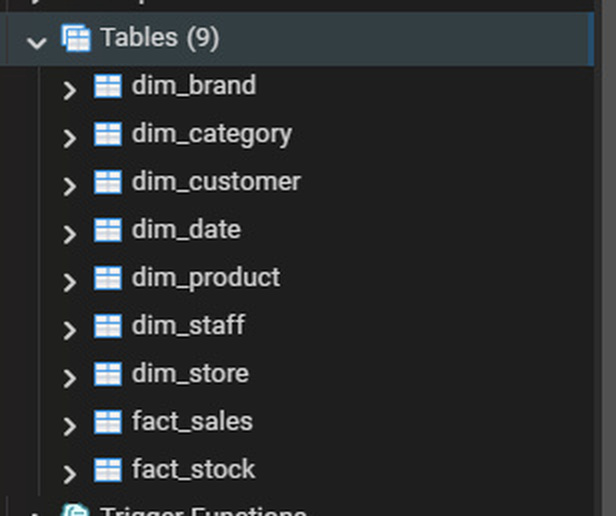
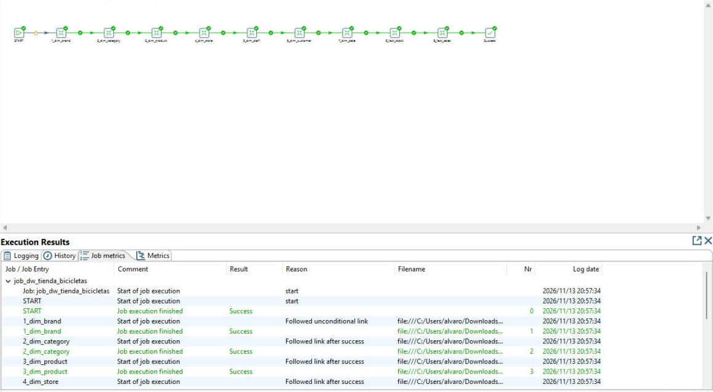
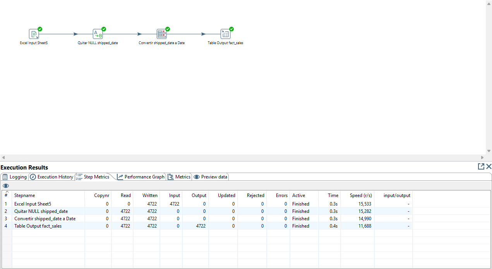
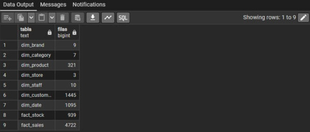
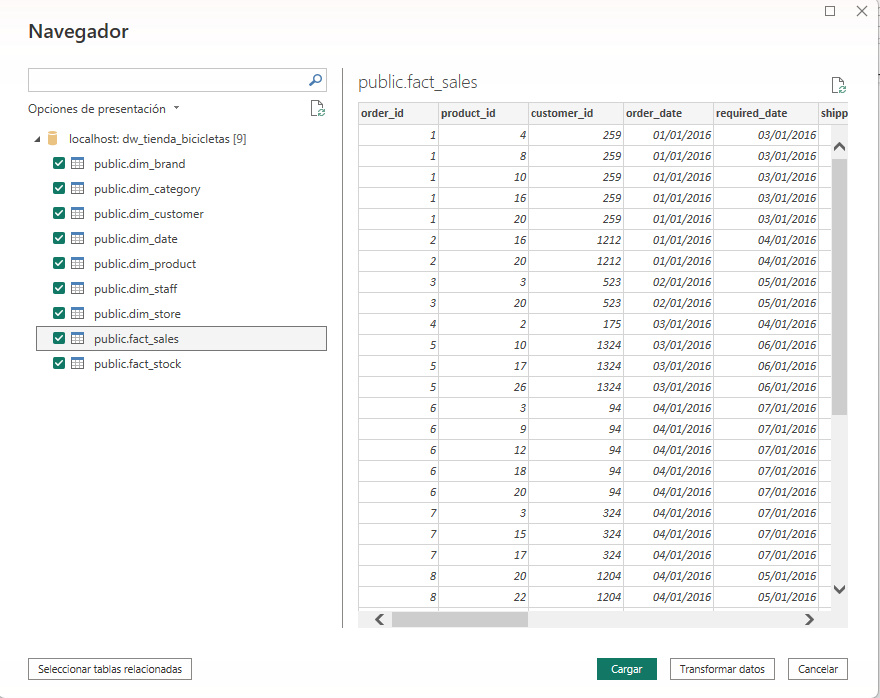
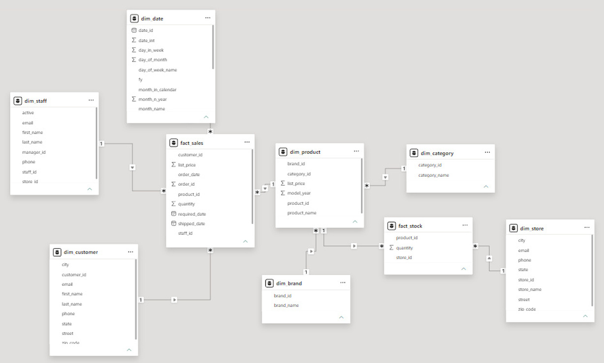
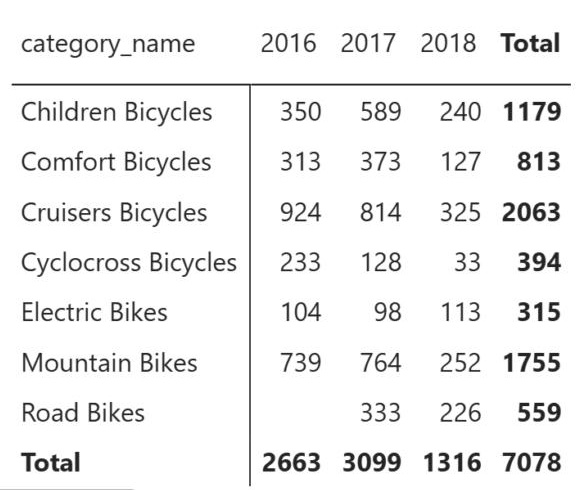
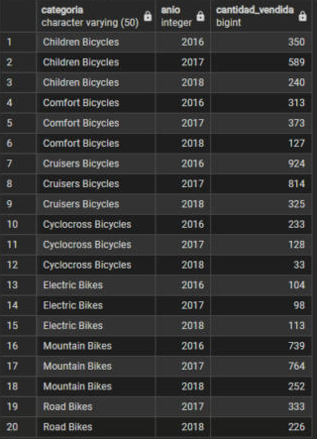

# Caso de estudio Copo de Nieve: Tienda de bicicletas

**Universidad:** Escuela Politécnica Nacional  
**Asignatura:** Business Intelligence  
**Paralelo:** GR2SW  
**Integrantes:** Alvaro Montalvan, Jonathan Cuasapaz, Ruben Cuenca, Jeremy Jimenez  
**Fecha:** 13 de noviembre de 2026

---

## Índice

1. [Objetivos](#1-objetivos)
2. [Introducción](#2-introducción)
3. [Desarrollo](#3-desarrollo)
    - [3.1 Base de datos y modelo en PostgreSQL](#31-base-de-datos-y-modelo-en-postgresql)
    - [3.2 Carga de datos con Pentaho](#32-carga-de-datos-con-pentaho)
    - [3.3 Importación y modelo en Power BI](#33-importación-y-modelo-en-power-bi)
    - [3.4 Productos vendidos por categoría y año](#34-productos-vendidos-por-categoría-y-año)
4. [Conclusiones](#4-conclusiones)
5. [Referencias bibliográficas](#5-referencias-bibliográficas)
6. [Declaracion uso de IA](#6-uso-de-herramientas-de-ia)

**Figuras**

- [Figura 1. Tablas del modelo en pgAdmin](#figura-1)
- [Figura 2. Trabajo de carga en Pentaho](#figura-2)
- [Figura 3. Transformación de ventas en Pentaho](#figura-3)
- [Figura 4. Filas cargadas por tabla](#figura-4)
- [Figura 5. Navegador de Power BI](#figura-5)
- [Figura 6. Modelo completo en Power BI](#figura-6)
- [Figura 7. Matriz en Power BI](#figura-7)
- [Figura 8. Consulta en pgAdmin](#figura-8)

---

## 1. Objetivos

1. Crear en PostgreSQL el modelo copo de nieve de la tienda de bicicletas y cargarlo con Pentaho desde `TiendaBicicletas.xlsx`, limpiando los datos con los pasos de la herramienta.
2. Importar el modelo a Power BI y consultar desde ahí la cantidad de productos vendidos por categoría y año, para comprobar que las tablas y sus relaciones permiten analizar los datos.

## 2. Introducción

En un modelo copo de nieve las dimensiones se dividen en varios niveles, a diferencia del modelo estrella, donde cada dimensión es una sola tabla. Aquí el producto se separa de su marca y de su categoría. Los datos están en un libro de Excel con ocho hojas más una de calendario. Se cargaron a PostgreSQL con Pentaho Data Integration y se analizaron en Power BI.

## 3. Desarrollo

### 3.1 Base de datos y modelo en PostgreSQL

La base `dw_tienda_bicicletas` y sus tablas se crearon con un solo script SQL; los datos no pasan por ningún script. El modelo tiene nueve tablas: siete dimensiones (`dim_brand`, `dim_category`, `dim_product`, `dim_store`, `dim_staff`, `dim_customer`, `dim_date`) y dos de hechos. `fact_sales` guarda cada línea de pedido y `fact_stock` el inventario por tienda y producto. `dim_product` apunta a `dim_brand` y a `dim_category`, y ahí está el copo de nieve ([Figura 1](#figura-1)).

**Figura 1.** Tablas del modelo en pgAdmin

*Las nueve tablas de la base.*

### 3.2 Carga de datos con Pentaho

Cada tabla tiene su propia transformación, que lee la hoja de Excel y escribe en PostgreSQL. Un trabajo las ejecuta en orden: primero las dimensiones y al final las tablas de hechos ([Figura 2](#figura-2)).

**Figura 2.** Trabajo de carga en Pentaho

*Las nueve transformaciones terminan en verde.*

El Excel trae la palabra `NULL` escrita como texto en el teléfono de los clientes, en el jefe de los empleados y en la fecha de envío de 508 pedidos. Se quitó con el paso Replace in string y el tipo de dato se corrigió con Select values, así la fecha de envío queda vacía y no como texto ([Figura 3](#figura-3)).

**Figura 3.** Transformación de ventas en Pentaho

*Lectura, limpieza y carga de `fact_sales`: 4722 filas.*

Después de la carga se contaron las filas de cada tabla y coinciden con las hojas del Excel ([Figura 4](#figura-4)).

**Figura 4.** Filas cargadas por tabla

*Conteo de registros de las nueve tablas.*

### 3.3 Importación y modelo en Power BI

Power BI se conectó a la base en modo Importar y cargó las nueve tablas ([Figura 5](#figura-5)). Detectó ocho relaciones de varios a uno por las claves, y se ven en la [Figura 6](#figura-6). No hay relación entre `dim_store` y `fact_sales`: con ella existirían dos caminos entre tienda y ventas (uno por `fact_stock` y otro directo) y Power BI no permitiría filtrar bien.

**Figura 5.** Navegador de Power BI

*Tablas seleccionadas para importar.*

**Figura 6.** Modelo completo en Power BI

*Las nueve tablas con sus ocho relaciones.*

### 3.4 Productos vendidos por categoría y año

En Power BI se armó una matriz con la categoría en las filas, el año de `dim_date` en las columnas y la suma de `quantity` de `fact_sales` como valor ([Figura 7](#figura-7)). La misma consulta se ejecutó en pgAdmin y dio los mismos números ([Figura 8](#figura-8)). Road Bikes aparece vacía en 2016 porque el Excel no trae ninguna venta de esa categoría ese año: sus productos más antiguos son modelo 2017, así que no hay nada que cargar ni filtrar.

**Figura 7.** Matriz en Power BI

*Unidades vendidas por categoría y año.*

**Figura 8.** Consulta en pgAdmin

*Resultado de la consulta por categoría y año.*

## 4. Conclusiones

1. El modelo copo de nieve quedó creado en PostgreSQL con nueve tablas, y Pentaho cargó todas desde el Excel sin errores. Los textos `NULL` se limpiaron con pasos de Pentaho y los conteos de filas coinciden con las hojas de origen.
2. Power BI importó las nueve tablas y encontró las ocho relaciones sin crear ninguna a mano. La consulta dio 7078 unidades vendidas en total: 2663 en 2016, 3099 en 2017 y 1316 en 2018. Cruisers Bicycles vendió más (2063) y Electric Bikes menos (315). Road Bikes no tiene ventas en 2016 porque sus productos empiezan en el modelo 2017. Power BI y PostgreSQL dan los mismos valores.

## 5. Referencias bibliográficas

Kimball, R., & Ross, M. (2013). *The data warehouse toolkit: The definitive guide to dimensional modeling* (3.ª ed.). John Wiley & Sons.

Microsoft. (s. f.). *Understand star schema and the importance for Power BI*. Microsoft Learn. https://learn.microsoft.com/en-us/power-bi/guidance/star-schema

PostgreSQL Global Development Group. (s. f.). *PostgreSQL documentation*. https://www.postgresql.org/docs/

Hitachi Vantara. (s. f.). *Pentaho Data Integration documentation*. https://docs.hitachivantara.com/r/en-us/pentaho-data-integration-and-analytics

## 6. Declaracion uso de IA

Se usó Claude (Anthropic) en aproximadamente un 15 % del trabajo, como ayuda con los scripts SQL, el formato del informe y la corrección de ortografía, gramática y coherencia.
